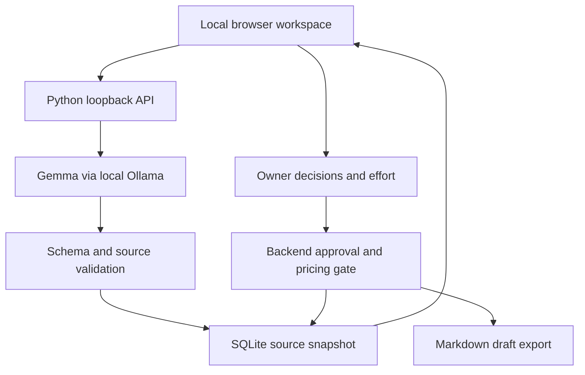

# ScopeLedger — Product and architecture

Owner: Mir Quadri / Orchestrate AI. Created October 14, 2026.

## Product decision

Build one narrow tool for freelance developers and small agencies: turn a client's new requests into an evidence-backed scope conversation and an owner-reviewed change-order draft.

The problem is familiar in delivery work: a small request can expand a fixed-price project, but the freelancer hesitates to discuss cost without explaining what changed. ScopeLedger helps make that conversation concrete. It does not decide whether a contract is enforceable or send a bill.

Job to be done: “When a client asks for something extra, help me establish what we agreed, decide what changed, and respond clearly without damaging the relationship.”

Target first user: a solo web developer with fixed-price engagements, short written scopes and requests arriving in messages. Focus excludes enterprise procurement, legal document review and automatic email ingestion.

## MVP acceptance criteria

1. Given scope and request lines, the live model proposes one decision per request.
2. Each result shows the exact source request and valid referenced scope lines.
3. Missing, duplicate or fabricated source IDs reject the complete model response.
4. The owner can override classifications and select effort in quarter-hour increments.
5. Prices derive exclusively from owner estimates and rate, using decimal arithmetic in the backend.
6. Only selected changes with positive estimates enter the export; client acceptance remains pending.
7. Editing source text clears displayed prior decisions. Live source snapshots remain immutable in each stored analysis.
8. Local reviews survive a server restart; deletion removes the selected review and associated audit events.
9. Sample mode is labeled as hand-authored; it cannot masquerade as live AI.

## Design direction

A calm, editorial working desk: warm off-white canvas, forest-green actions, restrained lime highlights and readable system typography. The interface begins with the two documents, then reveals decisions and effort. Status colors supplement text labels. All document content uses text nodes, not HTML interpolation. Mobile uses a single column; keyboard users have visible focus states and labeled controls. Live analysis disables source inputs while running; errors explain the next action.

Primary action: review a new ask. Secondary action: inspect a sample. The metric is proposed owner-selected value, never “recovered revenue.” No fabricated customers, testimonial quotes or savings claims.

## Architecture

Model responsibility: semantic comparison, potential matches, explanation and uncertainty. Application responsibility: source identity, complete coverage, validation, state, arithmetic, approval and export. Human responsibility: deciding if the suggestion is correct, effort, rate, client discussion and acceptance.

Endpoints: `GET /api/health`, `/api/history`, `/api/analysis/{id}`; `POST /api/analyze`, `/api/review`, `/api/export`, `/api/delete`. The model endpoint is fixed to `127.0.0.1:11434`. The application binds to `127.0.0.1:8765` by default. The browser cannot redirect the model to an arbitrary service.

Each analysis stores normalized source lines, SHA-256 source fingerprint, validated model suggestions, runtime metrics and the latest owner review. Separate audit events record analysis, owner review and export. The audit log is local application history; it is not tamper-proof or an independent legal record. The most recent analysis is restored on launch. Prior analyses are available through the local history API; a full history picker is future work.

## Trust boundaries and limits

Client documents are untrusted data. The prompt tells the model to ignore instructions within them. Structured outputs constrain shape; validation checks source IDs and coverage. These measures do not prove semantic truth or eliminate prompt injection. Conflicting, bundled or vague requests should prompt a clarification, and the model may still get them wrong.

Same-origin JSON POST checks and strict Host checks reduce browser-driven attacks against the loopback server. No remote CORS access is enabled. A CSP blocks external executable assets in the local UI. Documents and results remain on the local machine but are not encrypted at rest. Local administrators and malware can access them. Multi-user exposure is unsupported. The static hosted demo contains only fictional sample data and makes no local-model connection.

## Business model and validation

Pricing hypothesis: $19 one-time personal tool, or $49 assisted installation. These are experiments, not established willingness to pay. A freelancer's hourly rate is an estimate input, not the product price. No subscription billing is implemented.

Interview five freelance developers. Ask them to bring a sanitized recent scope disagreement. Measure review completion, overrides, whether the draft was usable, and actual willingness to pay. Do not count a demo click as a customer. Targets: 4/5 complete without help; 3/5 would use on their next engagement; at least one paid pilot. These are proposed targets, not results.

## Delivery sequence

- Delivered in this build: local workflow, static guided preview, evaluation harness, tests, source kit and submission draft.
- Before contest submission: inspect evaluation results; run one owner demo on target hardware; create a new public repository; provide a judge-accessible demo or video; replace the draft's missing URLs; verify DEV/MLH linkage; publish the DEV post before the deadline.
- Next product iteration: first-user feedback, history picker, request splitting and import quality. Avoid adding unrelated sponsor tools before the core task is reliable.

## Partner selection

Primary target: Best Use of Gemma, because Gemma performs the semantic comparison at the core of the live app. Enter only with actual inference evidence. Do not claim Render, MongoDB, Mastra, Sentry, Copilot, .tech or other partner categories for configuration files or unexecuted ideas. Claim credits only if a chosen integration needs them. Local inference avoids a dependency on sponsor-account setup for the core experience.
